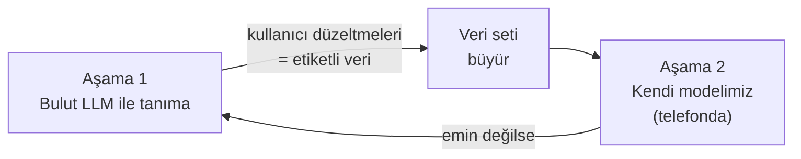

# Zindeo — Product Vision

| | |
|---|---|
| **Durum** | Taslak v0.1 |
| **Sahibi** | Taner Yıldırım |
| **Ekip** | Taner Yıldırım, Yavuz Tuğcan, Ece Coşdur |
| **Danışman** | Dr. Arman Savran |
| **Son güncelleme** | 23 Ekim 2026 |

---

## 1. Vizyon

> **Ne yediğini bilmek, bir fotoğraf kadar kolay olsun.**

Zindeo, Türkiye'de kilo vermek, kilo almak ya da formunu korumak isteyen herkesin yediklerini saniyeler içinde ve doğru şekilde kaydedebildiği bir kalori ve beslenme takip uygulamasıdır. Kullanıcı tabağının fotoğrafını çeker; Zindeo yemeği tanır, porsiyonu tahmin eder, kaloriyi ve besin değerlerini hesaplar.

## 2. Problem

Kalori takibi işe yarar, ancak insanlar bırakır. Bunun başlıca nedenleri şunlardır:

1. **Kayıt zahmetlidir.** Her öğünde yemeği aramak, doğru kaydı seçmek ve gramajı tahmin etmek gerekir. Günde 3–5 kez yapılan bu iş birkaç hafta içinde bıraktırır.
2. **Türk mutfağı iyi temsil edilmez.** Global uygulamaların veritabanları ve yapay zekâ modelleri Batı yemeklerine göre kurulmuştur. Karnıyarık, ezogelin, kuru fasulye–pilav gibi ev yemekleri ya yoktur ya da yanlış tanınır. (Kendi testimizde FatSecret karnıyarığı "etli yufka" olarak tanıdı.)
3. **Porsiyon tahmini kullanıcıya bırakılır.** "Bir kase" ya da "200 g" demek çoğu kişi için tahminden ibarettir; kalori hatasının en büyük kaynağı budur.
4. **Fotoğraftan tanıma yapan uygulamalar buluta bağımlıdır.** İnternet yoksa çalışmazlar, her tarama şirkete maliyet çıkarır ve bu maliyet kullanıcıya yüksek abonelik fiyatı olarak yansır.

## 3. Hedef kullanıcı

**Birincil:** Türkiye'de yaşayan, 18–45 yaş arası, diyet yapan ya da spor yapan ve kalorisini takip etmek isteyen akıllı telefon kullanıcıları.

- **Kilo vermek isteyen:** Belirli bir hedef kilosu var, günlük kalori açığını takip etmek istiyor.
- **Spor yapan:** Kas kazanımı veya form koruma için protein ve makrolarını takip ediyor.
- **Bilinçli beslenen:** Kilo hedefi yok, ama ne yediğini görmek istiyor.

Ayrıntılı personalar: [personas.md](personas.md) *(hazırlanacak)*

## 4. Çözüm ve değer önerisi

| Kullanıcı ihtiyacı | Zindeo'nun cevabı |
|---|---|
| Hızlı kayıt | Fotoğraf çek → yemek, porsiyon ve kalori otomatik gelsin; sadece onayla |
| Türk yemeklerinde doğruluk | Türk mutfağına özel yemek veritabanı ve Türk yemekleriyle eğitilmiş yapay zekâ |
| Doğru porsiyon | Tabağı referans alan otomatik porsiyon tahmini; gerekirse tek dokunuşla düzeltme |
| Kişisel hedef | Kilo, boy, yaş, aktivite ve hedefe göre günlük kalori ve makro hedefleri |
| Klasik kayıt | Arama ve barkod ile hızlı manuel kayıt; porsiyon birimleri (kase, dilim, adet, gram) |
| Uygun fiyat | Temel takip ücretsiz; uzun vadede yapay zekânın telefonda çalışması sayesinde düşük maliyet |

## 5. Neden Zindeo kazanır (farklılaşma)

1. **Türk mutfağında en doğru tanıma.** Kendi topladığımız ve etiketlediğimiz Türk yemeği veri setiyle eğitilmiş model.
2. **Tabak referanslı porsiyon tahmini.** Derinlik sensörü (Cal AI) veya parmak gibi ek bir referans nesne (Kalorita) gerektirmez.
3. **Telefonda çalışan yapay zekâ (hedef).** İnternetsiz çalışır, fotoğraf telefondan çıkmaz, tarama başına maliyet yoktur.
4. **iOS ve Android aynı anda.** Türk yemeğine odaklanan en yakın rakipler (Kalorita, Neyedim) yalnızca iOS'ta.
5. **Sürekli gelişen model.** Kullanıcıların düzelttiği her kayıt (izinleriyle) modeli daha da iyileştirir.

Rakip analizinin tamamı: [`research/Zindeo_Rakipler_ve_Literatur.xlsx`](../research/Zindeo_Rakipler_ve_Literatur.xlsx)

## 6. Ürün stratejisi: iki aşamalı yapay zekâ

- **Aşama 1:** Kamera ile tanıma, backend üzerinden çağrılan bir görsel LLM ile yapılır. Uygulama erken yayınlanır, gerçek kullanıcı ve gerçek veri toplanır.
- **Aşama 2:** PyTorch ile eğitilen kendi modelimiz telefona taşınır. LLM, yalnızca modelin emin olmadığı durumlarda yedek olarak kalabilir.
- **Kural:** Kalori ve besin değerleri hiçbir zaman doğrudan LLM'den alınmaz. Yapay zekâ yalnızca *yemeğin ne olduğunu* ve *gramajını* söyler; değerler Zindeo'nun besin veritabanından hesaplanır.

## 7. İş modeli (özet)

**Freemium:**

- **Ücretsiz:** Hedef hesaplama, arama ve barkodla kayıt, günlük ve haftalık takip, günde sınırlı sayıda kamera taraması.
- **Premium (abonelik):** Sınırsız kamera taraması, ayrıntılı makro ve mikro besin analizleri, ileri raporlar ve MVP sonrası gelecek özellikler (buzdolabından tarif önerisi vb.).

Fiyatlandırma ve limitler: [business-model.md](business-model.md) *(hazırlanacak)*

## 8. Kapsam

| Karar | Değer |
|---|---|
| İlk pazar | Türkiye (uygulama baştan çok dilli kurulur, global açılım sonra) |
| Platform | iOS ve Android, aynı anda |
| Mobil teknoloji | React Native |
| Hesap | Apple ile giriş, Google ile giriş, e-posta |
| MVP kapsamı | Geliştirme sırasında netleşecek; aday liste [PRD](prd.md)'de |

## 9. Başarıyı nasıl ölçeceğiz

| Metrik | Neden önemli |
|---|---|
| **D7 / D30 retention** | Kalori uygulamalarının asıl sorunu bırakılmalarıdır |
| **Aktif kullanıcı başına günlük kayıt sayısı** | Kayıt alışkanlığının oluşup oluşmadığını gösterir |
| **Kamera ile yapılan kayıtların oranı** | Farklılaştırıcı özelliğimizin kullanılıp kullanılmadığını gösterir |
| **Tanıma kabul oranı** (düzeltme yapılmadan onaylanan taramalar) | Yapay zekâ kalitesinin kullanıcı gözünden ölçüsü |
| **Ücretsizden Premium'a dönüşüm** | Gelir |

Hedef değerler: [metrics.md](metrics.md) *(hazırlanacak)*

## 10. İlkeler

1. **Hız her şeyden önce gelir.** Bir öğünü kaydetmek 10 saniyeden uzun sürmemeli.
2. **Emin değilsen sor.** Yapay zekâ yanlış ama kendinden emin bir cevap vermek yerine kullanıcıya 2–3 seçenek sunar.
3. **Kullanıcının verisi kullanıcınındır.** Fotoğraflar yalnızca açık izinle model eğitiminde kullanılır; izin her an geri alınabilir.
4. **Sağlıklı sınırlar.** Uygulama tehlikeli düzeyde düşük kalori hedeflerine izin vermez ve tıbbi tavsiye vermez.
