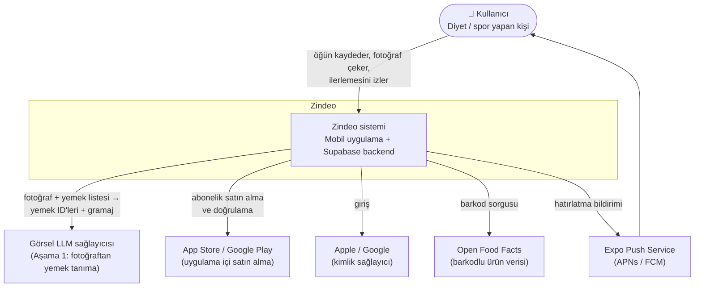
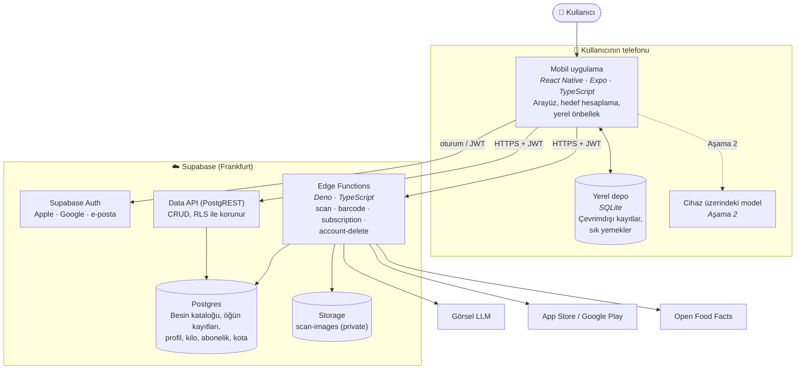
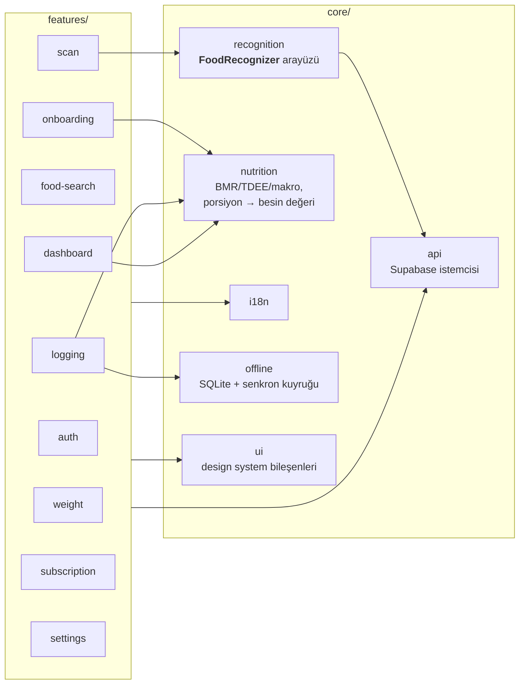
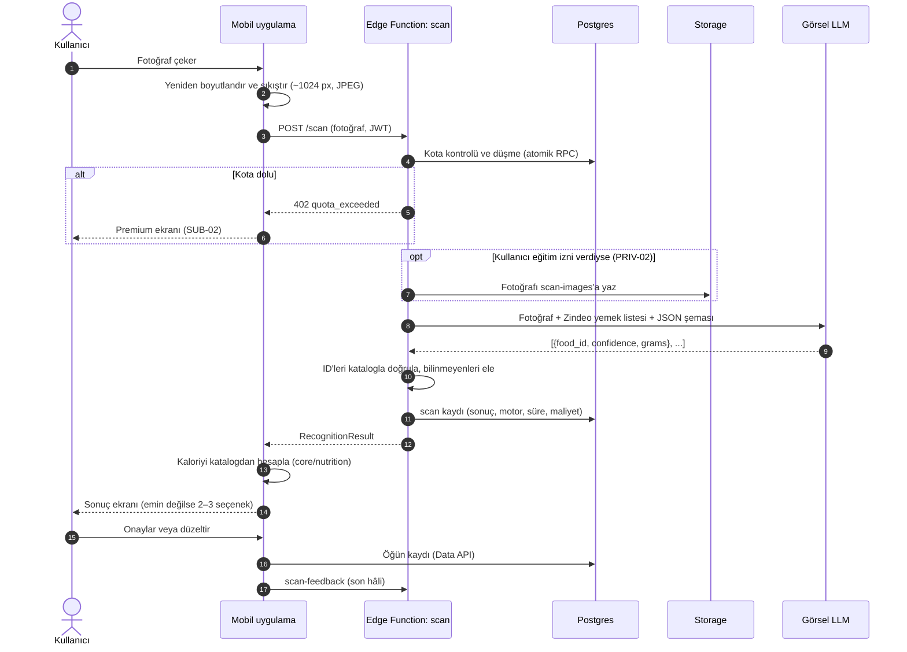
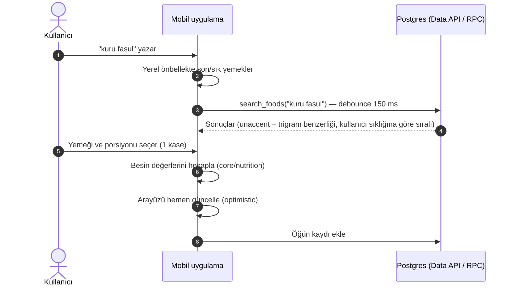
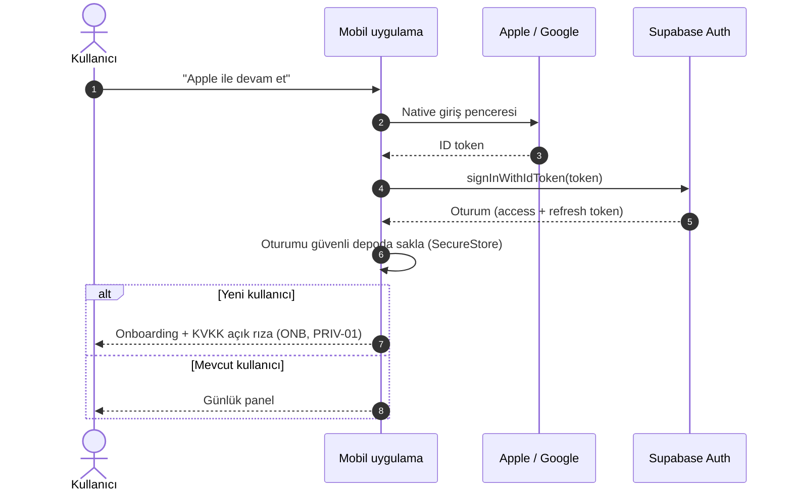
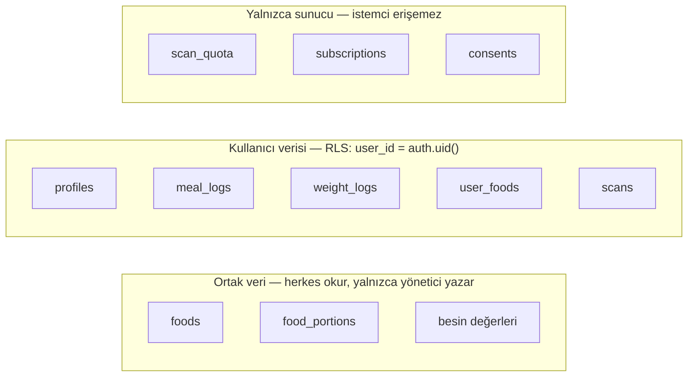
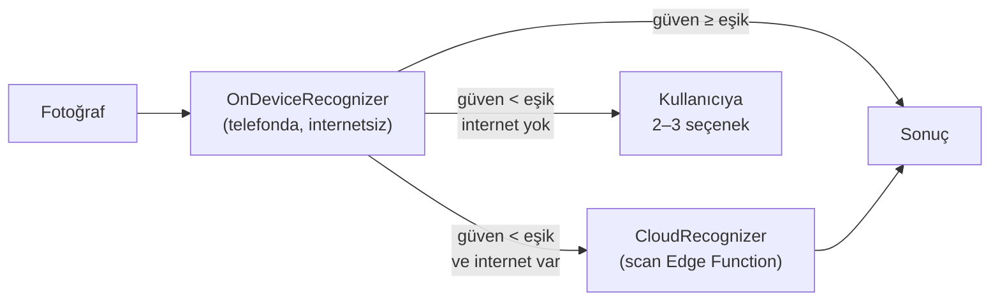

# Zindeo — Mimari Dokümanı

| | |
|---|---|
| **Durum** | Taslak v0.1 |
| **Sahibi** | Taner Yıldırım |
| **Son güncelleme** | 23 Ekim 2026 |
| **İlgili** | [PRD](../01-product/prd.md) · [ADR'ler](adr/) |

---

## 1. Amaç ve kapsam

Bu doküman Zindeo'nun **nasıl inşa edileceğini** üst seviyede tanımlar: sistemin parçaları, aralarındaki ilişkiler, kritik akışlar ve bu yapıyı yönlendiren ilkeler. Diyagramlar [C4 modeli](https://c4model.com/) seviyelerine göre düzenlenmiştir:

1. **Sistem bağlamı:** Zindeo ve dış dünya
2. **Container'lar:** Zindeo'yu oluşturan çalıştırılabilir parçalar
3. **Bileşenler:** Mobil uygulamanın ve backend'in iç yapısı

Ayrıntılar ilgili dokümanlarda yer alır: veri modeli (`04-data/`), API sözleşmesi (`05-api/`), ML tarafı (`06-ml/`).

## 2. Mimariyi yönlendiren etkenler

| Etken | Kaynak | Mimariye etkisi |
|---|---|---|
| iOS + Android, küçük ekip | ADR-0002 | Tek kod tabanı: React Native + Expo |
| Tek backend sağlayıcısı | ADR-0003 | Tüm sunucu tarafı Supabase'te |
| Tanıma motoru değişecek (LLM → kendi modelimiz) | Vision §6 | Tanıma, `FoodRecognizer` arayüzünün arkasında |
| Besin değerleri tutarlı olmalı | PRD `FOOD`, `SCAN` | Kalori ve makrolar yalnızca Zindeo veritabanından hesaplanır |
| API anahtarı istemcide olamaz, tarama limiti atlatılamaz | NFR-08, `SUB-01` | LLM çağrısı ve limit kontrolü Edge Function'da |
| Sağlık verisi | `PRIV`, NFR-09 | RLS ile kullanıcı bazında erişim; özel (private) dosya deposu |
| Kayıt 10 saniyeden kısa sürmeli | Vision §10 | Arama hızlı olmalı; sık kullanılanlar önde; iyimser (optimistic) arayüz güncellemeleri |

## 3. Seviye 1 — Sistem bağlamı



| Dış sistem | Ne için | Not |
|---|---|---|
| Görsel LLM | Aşama 1'de fotoğraftan yemek tanıma | Sağlayıcı, test setinde karşılaştırma ile seçilecek (açık karar) |
| App Store / Google Play | Abonelik satışı ve makbuz doğrulama | Dijital içerik için mağaza ödemesi zorunlu |
| Apple / Google | Sosyal giriş | Supabase Auth üzerinden |
| Open Food Facts | Barkodlu ürünler (`BAR`) | Bulunan ürün kendi veritabanımıza kopyalanır (ODbL koşullarıyla) |
| Expo Push Service | Bildirimler (`NOTIF`) | Expo'nun parçası; ayrı bir backend değil |

## 4. Seviye 2 — Container'lar



| Container | Teknoloji | Sorumluluk |
|---|---|---|
| **Mobil uygulama** | React Native, Expo, TypeScript | Tüm arayüz; hedef hesaplama; kamera; okuma ve basit yazma işlemlerinde doğrudan Data API kullanımı |
| **Yerel depo** | SQLite (Expo) | Çevrimdışı kayıt kuyruğu (`LOG-06`), son ve sık kullanılan yemeklerin önbelleği |
| **Supabase Auth** | Supabase | Kayıt, giriş, oturum yenileme; JWT üretimi |
| **Data API** | PostgREST (Supabase) | Basit CRUD: öğün kaydı, kilo, profil, katalog okuma. Güvenliği RLS sağlar |
| **Postgres** | Supabase Postgres | Tek doğruluk kaynağı. Arama için `pg_trgm` ve `unaccent`; atomik işlemler için RPC fonksiyonları |
| **Edge Functions** | Deno, TypeScript | Sır (secret) gerektiren veya güvenilmemesi gereken işler: LLM çağrısı, tarama kotası, makbuz doğrulama, barkod sorgusu, hesap silme |
| **Storage** | Supabase Storage | Tarama fotoğrafları. Bucket private, erişim imzalı URL ile |

### Data API mi, Edge Function mı?

| Kural | Örnek |
|---|---|
| Kullanıcının kendi verisini okuyan/yazan, sır gerektirmeyen basit işlemler → **Data API + RLS** | Öğün kaydı ekleme, kilo girme, katalogda arama |
| Birden fazla tabloyu tutarlı biçimde değiştiren işlemler → **Postgres RPC fonksiyonu** | Kopyala-yapıştır öğün, kota düşme |
| Sır, dış servis veya güvenilmeyen istemci mantığı → **Edge Function** | LLM tarama, makbuz doğrulama, hesap silme |

## 5. Seviye 3 — Bileşenler

### 5.1 Mobil uygulama

Kod, **özellik (feature) bazlı** düzenlenir. Her özellik kendi ekranlarını, hook'larını ve API çağrılarını içerir; ortak altyapı `core/` altındadır.



**`FoodRecognizer` arayüzü.** Tanıma motorunu uygulamanın geri kalanından ayıran sözleşme:

```ts
interface FoodRecognizer {
  recognize(image: ImageInput): Promise<RecognitionResult>;
}

interface RecognitionResult {
  items: Array<{
    candidates: Array<{ foodId: string; confidence: number }>; // en olası önce
    estimatedGrams: number;
  }>;
  engine: 'cloud-llm' | 'on-device';
}
```

- Aşama 1: `CloudRecognizer`, `scan` Edge Function'ını çağırır.
- Aşama 2: `OnDeviceRecognizer` modeli telefonda çalıştırır. Model emin değilse `CloudRecognizer`'a devredebilir (`HybridRecognizer`).
- Sonuçta **hiçbir zaman kalori yoktur**. Kalori ve makrolar `core/nutrition` tarafından katalog verisinden hesaplanır.

**`core/nutrition`.** Saf (yan etkisiz) TypeScript fonksiyonlarından oluşur: BMR, TDEE, kalori hedefi, makro dağılımı, `porsiyon × miktar → besin değerleri`. Birim testleri en yoğun bu modülde olacaktır. Formüller `04-data/nutrition-calculation.md` dokümanında tanımlanır.

### 5.2 Edge Functions

| Fonksiyon | Tetikleyen | Görev | PRD |
|---|---|---|---|
| `scan` | Uygulama | Kota kontrolü → fotoğrafı sakla (izin varsa) → LLM'e sor → çıktıyı katalogla doğrula → sonucu döndür | `SCAN`, `SUB-01`, `PRIV-02` |
| `scan-feedback` | Uygulama | Kullanıcının onayladığı/düzelttiği sonucu taramaya bağlar (eğitim etiketi) | `SCAN-04/05`, `PRIV-02` |
| `barcode-lookup` | Uygulama | Barkodu önce kendi veritabanında, yoksa Open Food Facts'te arar ve sonucu kataloğa ekler | `BAR-01` |
| `subscription-verify` | Uygulama | Satın alma makbuzunu Apple/Google ile doğrular, abonelik durumunu yazar | `SUB-02..04` |
| `store-webhook` | Apple / Google | Yenileme, iptal ve iade bildirimlerini işler | `SUB` |
| `account-delete` | Uygulama | Kullanıcının tüm verisini, fotoğraflarını ve auth kaydını siler | `AUTH-05` |

Ortak kod (`_shared/`): JWT doğrulama, hata formatı, loglama, LLM istemcisi.

## 6. Kritik akışlar

### 6.1 Kamera ile tarama (Aşama 1)



**Tasarım notları**
- **Kota, LLM çağrısından önce düşülür.** Böylece paralel isteklerle limit aşılamaz. LLM hatası olursa kota iade edilir.
- **LLM'e yemek listesi verilir ve çıktı JSON şemasıyla sınırlanır.** LLM yalnızca kataloğumuzdaki ID'leri döndürebilir. Katalogda olmayan ID'ler sunucuda elenir.
- **Fotoğraf istemcide küçültülür.** Yükleme süresi ve LLM maliyeti düşer.
- **Her tarama kaydedilir** (motor, süre, maliyet, sonuç). Bu kayıtlar maliyet takibini (NFR-11) ve Aşama 2'de LLM ile kendi modelimizin karşılaştırılmasını sağlar.
- **LLM erişilemezse** kullanıcıya hata gösterilir ve arama ekranına yönlendirilir (NFR-10).

### 6.2 Arama ile kayıt



### 6.3 Kimlik doğrulama



## 7. Veri sahipliği ve güvenlik



- **RLS her tabloda açıktır.** Varsayılan kural: erişim yok. İzinler tablo tablo açılır.
- **Abonelik ve kota tablolarına istemci yazamaz.** Yalnızca Edge Function'lar (service role) yazar. Böylece istemci kendini Premium yapamaz.
- **Sırlar** (LLM anahtarı, mağaza anahtarları) yalnızca Edge Function ortam değişkenlerinde durur.
- **Fotoğraflar** private bucket'ta tutulur. Eğitim izni olmayan kullanıcıların fotoğrafları hiç saklanmaz.
- **Açık rıza kayıtları** (ne zaman, hangi metin sürümüne, hangi izin) denetlenebilir şekilde saklanır.

Tablo şemaları ve ilişkiler: `04-data/erd.md` *(hazırlanacak)*.

## 8. Repo yapısı

Tek repo (monorepo):

```
zindeo/
├── app/                    # Expo uygulaması
│   ├── app/                # Ekranlar (Expo Router)
│   ├── src/features/       # Özellik modülleri
│   ├── src/core/           # api, recognition, nutrition, i18n, offline, ui
│   └── locales/            # tr.json, en.json
├── supabase/               # Supabase CLI projesi
│   ├── migrations/         # Şema değişiklikleri (SQL, sürüm kontrollü)
│   ├── functions/          # Edge Functions (+ _shared/)
│   └── seed.sql            # Geliştirme verisi
├── ml/                     # PyTorch: veri hazırlama, eğitim, değerlendirme
└── docs/
```

**Kural:** Veritabanında yapılan her değişiklik bir migration dosyasıyla yapılır. Panelden elle şema değişikliği yapılmaz.

## 9. Ortamlar

| Ortam | Nerede | Kullanım |
|---|---|---|
| **Local** | Supabase CLI ile bilgisayarda | Geliştirme ve testler. Her geliştiricinin kendi veritabanı vardır |
| **Staging** | Supabase bulut projesi (ücretsiz plan) | Ekip içi testler, TestFlight / dahili test sürümleri |
| **Production** | Supabase bulut projesi (Pro plan, beta öncesi) | Gerçek kullanıcılar |

Mobil uygulama hangi ortama bağlanacağını build profiline göre (EAS: `development`, `preview`, `production`) alır.

## 10. Evrim: Aşama 2



Aşama 1'den 2'ye geçerken değişen tek yer `core/recognition` içindeki uygulamadır (implementation). Ekranlar, veritabanı ve `scan` akışının geri kalanı aynı kalır. Model dosyası uygulamayla birlikte gelebilir veya Supabase Storage'dan indirilebilir; bu karar ML Design Doc'ta verilecektir.

## 11. Açık kararlar (gelecek ADR'ler)

| Konu | Seçenekler | Ne zaman |
|---|---|---|
| Aşama 1 görsel LLM sağlayıcısı | Gemini, Claude, GPT vb. | Türk yemeği test setiyle karşılaştırma sonrası |
| Uygulama içi satın alma | Kendi doğrulamamız (`subscription-verify`) veya RevenueCat | `SUB` geliştirmesinden önce |
| Uygulama durumu ve veri çekme | TanStack Query + Zustand (öneri) | Uygulama iskeleti kurulurken |
| Çevrimdışı senkronizasyon yöntemi | Basit yazma kuyruğu (öneri) veya senkron kütüphanesi | `LOG-06` geliştirmesinden önce |
| Cihaz üzerinde model çalışma zamanı | LiteRT, ExecuTorch | Aşama 2 |
| Çökme raporlama ve analitik | — | Beta öncesi |
