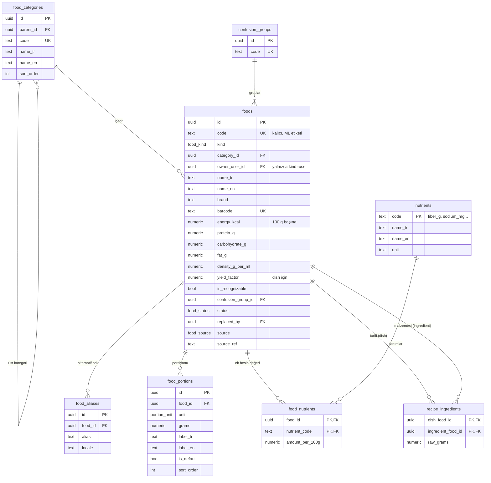
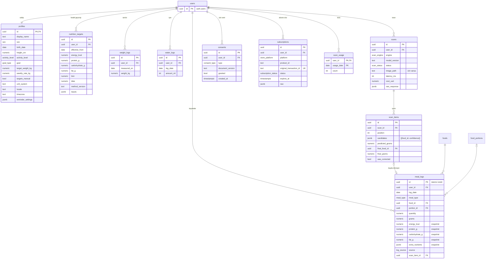

# Veri Modeli (ERD)

| | |
|---|---|
| **Durum** | Taslak v0.1 |
| **Sahibi** | Taner Yıldırım |
| **Son güncelleme** | 23 Ekim 2026 |
| **İlgili** | [Mimari §7](../03-architecture/architecture.md) · [Yemek Taksonomisi](food-taxonomy.md) · [Beslenme hesaplama](nutrition-calculation.md) |

---

> Bu doküman Postgres (Supabase) şemasının mantıksal modelidir. Gerçek şema `supabase/migrations/` altındaki SQL dosyalarıdır; bu doküman ile migration'lar çelişirse doküman güncellenir.

## 1. Genel kurallar

| Konu | Kural |
|---|---|
| Şema | Uygulama tabloları `public`, kullanıcı hesapları Supabase'in `auth.users` tablosu |
| Birincil anahtar | `uuid` (`gen_random_uuid()`); istisnalar belirtilmiştir |
| Zaman | `timestamptz`, UTC. Her tabloda `created_at`; değişebilen tablolarda `updated_at` (trigger ile) |
| Kullanıcının günü | `log_date date` alanı **kullanıcının yerel tarihidir** ve istemci tarafından gönderilir. Gece 00:30'da yenen yemek, kullanıcının o gün kabul ettiği tarihe yazılabilir |
| Sayılar | Besin değerleri ve gramlar `numeric(8,2)`; kalori `numeric(8,1)` |
| Enum'lar | Postgres `enum` tipleri (aşağıda listelenmiştir) |
| Adlandırma | Tablolar çoğul, `snake_case`; yabancı anahtarlar `<tablo_tekil>_id` |
| Silme | Kullanıcı verisi gerçekten silinir (`on delete cascade` ile `auth.users`'a bağlı). Katalogda silme yok, `deprecated` |

## 2. Diyagram

### 2.1 Katalog

### 2.2 Kullanıcı verisi

## 3. Enum'lar

| Tip | Değerler |
|---|---|
| `food_kind` | `dish`, `ingredient`, `branded`, `user` |
| `food_status` | `draft`, `verified`, `deprecated` |
| `food_source` | `turkomp`, `usda`, `zindeo_recipe`, `open_food_facts`, `label`, `user` |
| `portion_unit` | `gram`, `ml`, `serving`, `bowl`, `plate`, `slice`, `piece`, `tbsp`, `tsp`, `cup`, `tea_glass`, `handful` |
| `sex` | `male`, `female`, `unspecified` |
| `activity_level` | `sedentary`, `light`, `moderate`, `active`, `very_active` |
| `goal_type` | `lose`, `maintain`, `gain` |
| `meal_type` | `breakfast`, `lunch`, `dinner`, `snack` |
| `log_source` | `search`, `scan`, `barcode`, `copy`, `quick_add` |
| `scan_engine` | `cloud_llm`, `on_device` |
| `scan_status` | `success`, `failed`, `quota_exceeded` |
| `store_platform` | `app_store`, `play_store` |
| `subscription_status` | `trial`, `active`, `grace_period`, `expired`, `canceled`, `refunded` |
| `consent_type` | `kvkk_health_data`, `training_photos`, `marketing` |

## 4. Önemli tasarım kararları

### 4.1 Kayıtlarda besin değeri snapshot'ı

`meal_logs` kayıt anında hesaplanan gram, kalori ve makroları **kopyalar**. Neden:
- Katalogdaki bir değer düzeltildiğinde kullanıcının geçmiş günlerinin toplamları sessizce değişmez.
- Günlük panel tek bir tablodan, join yapmadan hızlıca toplanır.
- Bir yemek `deprecated` olsa bile eski kayıtlar doğru kalır.

`food_id` ve `portion_id` yine saklanır; kullanıcı kaydı düzenlerse değerler katalogdan yeniden hesaplanır.

### 4.2 Hedef geçmişi

`nutrition_targets` her yeniden hesaplamada **yeni satır** ekler (`effective_from`). Bir günün hedefi, o tarihten önceki en son kayıttır. Böylece geçmiş haftaların "hedefe uyum" grafikleri o dönemin hedefiyle doğru hesaplanır. `method_version` ve `inputs` hangi formül ve girdilerle hesaplandığını saklar.

### 4.3 İstemcinin ürettiği ID (çevrimdışı)

`meal_logs.id` istemcide üretilir (UUID v4). Çevrimdışı eklenen kayıt bağlantı geldiğinde tekrar gönderilirse aynı ID ile `upsert` edilir, çift kayıt oluşmaz (`LOG-06`).

### 4.4 Tarama ve eğitim verisi

- `scans` her tarama denemesini kaydeder (başarısızlar ve kota aşımları dahil): maliyet, süre ve motor karşılaştırması için.
- `scan_items.candidates` modelin tahminini, `final_food_id` / `final_grams` kullanıcının onayladığı sonucu tutar. İkisi arasındaki fark (`was_corrected`) hem kalite metriği hem de eğitim etiketidir.
- `image_path` yalnızca, tarama anında `training_photos` izni aktifse dolu olur.

### 4.5 Kota

`scan_usage (user_id, usage_date)` bir kullanıcının o günkü tarama sayısını tutar. `usage_date` kullanıcının saat dilimindeki tarihtir (`profiles.timezone`). Kota yalnızca `consume_scan_quota()` RPC'si ile, tek bir atomik `insert ... on conflict do update ... where count < limit` sorgusuyla düşülür. Premium kontrolü aynı fonksiyon içinde `subscriptions` tablosundan yapılır.

### 4.6 İzin kayıtları

`consents` **yalnızca ekleme** yapılan bir tablodur. İzin geri alındığında yeni bir `granted = false` satırı eklenir. Bir kullanıcının güncel izni, o tipteki en son satırdır. Bu yapı KVKK kapsamında "ne zaman, hangi metne, ne izin verdi" sorusunu cevaplar.

## 5. Arama

Aramanın Türkçe karakterlere duyarsız ve yazım hatalarına toleranslı olması gerekir (`FOOD-02`).

- Eklentiler: `unaccent`, `pg_trgm`.
- Türkçe büyük/küçük harf dönüşümü (`I→ı`, `İ→i`) Postgres'in varsayılan `lower()` fonksiyonunda doğru çalışmayabileceği için normalizasyon kendi fonksiyonumuzla yapılır: `normalize_tr(text)` → küçük harf + Türkçe karakterleri ASCII karşılıklarına çevirme + fazla boşlukları silme.
- `food_search` tablosu (veya materialized view): her yemek için `name_tr`, `name_en` ve tüm alternatif adların normalize edilmiş halleri; üzerinde **GIN trigram indeksi**.
- `search_foods(query, limit)` RPC'si: normalize edilmiş sorguyu trigram benzerliği ve önek eşleşmesiyle arar; sıralamada kullanıcının bu yemeği kaç kez kaydettiği (son 90 gün) ağırlık olarak eklenir (`FOOD-05`).
- Yalnızca `status = verified` katalog yemekleri ve kullanıcının kendi `user` yemekleri döner.

## 6. Erişim kontrolü (RLS)

Her tabloda RLS açıktır; aşağıda açıkça izin verilmeyen her şey yasaktır.

| Tablo | İstemci okuma | İstemci yazma | Not |
|---|---|---|---|
| `food_categories`, `nutrients`, `confusion_groups` | Herkes (giriş yapmış) | — | |
| `foods` | `verified` katalog **veya** `owner_user_id = auth.uid()` | Yalnızca `kind = user` ve kendi kaydı | Katalog seed/migration ile yazılır |
| `food_aliases`, `food_portions`, `food_nutrients` | Bağlı yemeği okuyabiliyorsa | Kendi `user` yemeği için | |
| `recipe_ingredients` | Herkes | — | |
| `profiles` | Kendi satırı | Kendi satırı | |
| `nutrition_targets` | Kendi | Kendi (ekleme) | |
| `meal_logs`, `weight_logs`, `water_logs` | Kendi | Kendi | |
| `scans`, `scan_items` | Kendi | `scan_items.final_*` alanları `scan-feedback` ile | Oluşturma yalnızca Edge Function |
| `scan_usage` | Kendi (kalan hakkı göstermek için) | — | Yalnızca `consume_scan_quota()` |
| `subscriptions` | Kendi | — | Yalnızca Edge Function |
| `consents` | Kendi | Kendi (yalnızca ekleme) | |

## 7. İndeksler

| Tablo | İndeks | Amaç |
|---|---|---|
| `meal_logs` | `(user_id, log_date)` | Günlük panel, haftalık özet |
| `meal_logs` | `(user_id, food_id, created_at)` | Sık/son yemekler |
| `weight_logs` | `unique (user_id, measured_on)` | Günde bir kilo kaydı (son giriş geçerli) |
| `nutrition_targets` | `(user_id, effective_from desc)` | Bir günün hedefini bulma |
| `foods` | `unique (code)`, `unique (barcode)` | Eşleme, barkod |
| `food_search` | GIN trigram | Arama |
| `scans` | `(user_id, created_at)` | Geçmiş, maliyet raporları |
| `consents` | `(user_id, type, created_at desc)` | Güncel izin |

## 8. Hesap silme

`account-delete` Edge Function sırasıyla:
1. Kullanıcının Storage'daki tüm fotoğraflarını siler.
2. `auth.users` kaydını siler; kullanıcıya bağlı tüm tablolar `on delete cascade` ile silinir.
3. Eğitim veri setine daha önce kopyalanmış fotoğraflar varsa onları da siler (ML Design Doc'ta tanımlanacak).

## 9. Değişiklik geçmişi

| Tarih | Sürüm | Değişiklik |
|---|---|---|
| 23.10.2026 | 0.1 | İlk taslak |
