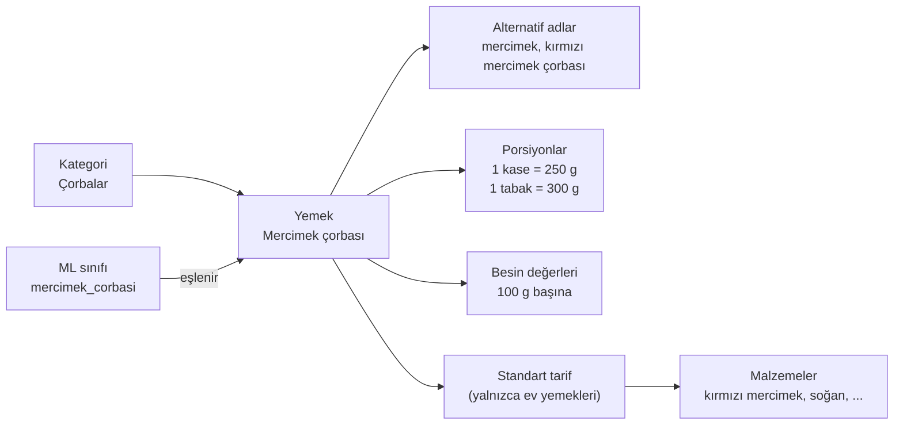

# Yemek Taksonomisi

| | |
|---|---|
| **Durum** | Taslak v0.1 |
| **Sahibi** | Taner Yıldırım |
| **Son güncelleme** | 23 Ekim 2026 |
| **İlgili** | PRD `FOOD`, `SCAN`, `BAR` · [ERD](erd.md) · [Beslenme hesaplama](nutrition-calculation.md) |

---

> Zindeo'da arama, kamera ve barkod **aynı yemek kataloğunu** kullanır. Bu doküman katalogdaki bir "yemeğin" ne olduğunu, nasıl adlandırıldığını, nasıl sınıflandırıldığını, besin değerlerinin nereden geldiğini ve yapay zekânın tanıdığı sınıflarla nasıl eşleştiğini tanımlar.

## 1. Temel kavramlar



| Kavram | Tanım |
|---|---|
| **Yemek (food)** | Kullanıcının kaydedebildiği her şey: bir ev yemeği, bir malzeme, paketli bir ürün veya kullanıcının kendi oluşturduğu kayıt |
| **Kategori** | Yemekleri gruplayan iki seviyeli hiyerarşi |
| **Alternatif ad (alias)** | Aramada aynı yemeğe götüren diğer adlar ve yazımlar |
| **Porsiyon** | Bir ölçü biriminin (kase, dilim, adet...) o yemek için gram karşılığı |
| **Standart tarif** | Bir ev yemeğinin besin değerinin hesaplandığı referans tarif |
| **ML sınıfı** | Yapay zekânın tanıyabildiği bir görsel sınıf; tam olarak bir yemeğe eşlenir |

## 2. Yemek türleri

| `kind` | Açıklama | Örnek | Besin değeri kaynağı |
|---|---|---|---|
| `dish` | Tarifli, hazırlanmış yemek | Karnıyarık, mercimek çorbası, lahmacun | Standart tarif → malzemeler (§5) |
| `ingredient` | Temel gıda, tek bileşen | Domates, yumurta, pirinç (çiğ), bulgur pilavı değil | TürKomp, USDA |
| `branded` | Barkodlu paketli ürün | X marka yoğurt 500 g | Ürün etiketi / Open Food Facts |
| `user` | Kullanıcının kendi oluşturduğu | "Annemin poğaçası" | Kullanıcı girişi; yalnızca o kullanıcı görür |

## 3. Kimlik ve adlandırma

### 3.1 Kod (`code`)

Her katalog yemeğinin (kullanıcı yemekleri hariç) veritabanı ID'sinden (UUID) ayrı, **insan tarafından okunabilir ve kalıcı** bir kodu vardır:

```
<kebab-case, ASCII, Türkçe karakter yok>
mercimek-corbasi
kuru-fasulye
karniyarik
pilav-pirinc
```

**Kurallar**
- Kod bir kez verildikten sonra **asla değiştirilmez ve başka bir yemek için tekrar kullanılmaz**. ML etiketleri, seed dosyaları ve analitik bu kodlara dayanır.
- Bir yemek kaldırılacaksa silinmez; `status = deprecated` yapılır ve `replaced_by` ile yerini alan yemeğe yönlendirilir.
- Aynı yemeğin farklı hazırlanışları besin değeri belirgin farklıysa ayrı yemektir (`kofte-izgara` ≠ `kofte-kizartma`), değilse alternatif addır.

### 3.2 Adlar

| Alan | Kural |
|---|---|
| `name_tr` | Türkiye'de en yaygın kullanılan ad, cümle düzeninde: "Mercimek çorbası" |
| `name_en` | İngilizce ad; Türk yemeklerinde özgün ad korunur, gerekirse açıklama eklenir: "Karnıyarık (stuffed eggplant)" |
| Alternatif adlar | Yöresel adlar, yaygın yazım hataları, kısaltmalar: `ezogelin` → "ezo gelin"; `simit` → "gevrek" |

Arama, Türkçe karakterlere duyarsızdır (`ı↔i`, `ş↔s`, `ğ↔g`, `ü↔u`, `ö↔o`, `ç↔c`) ve yazım hatalarını tolere eder (trigram benzerliği). Uygulaması için bkz. [ERD §5](erd.md).

## 4. Besin değerleri

Tüm değerler **100 g yenilebilir kısım başına** saklanır. İçecekler de 100 g başına saklanır; ml ile girişte `density_g_per_ml` kullanılır (su ve çoğu içecek için ≈ 1,0).

**Zorunlu alanlar** (bunlar olmadan yemek yayınlanmaz):

| Alan | Birim |
|---|---|
| `energy_kcal` | kcal |
| `protein_g` | g |
| `carbohydrate_g` | g |
| `fat_g` | g |

**İsteğe bağlı alanlar** (`FOOD-07`): lif, şeker, doymuş yağ, sodyum, kolesterol, potasyum ve diğer mikro besinler. Bunlar ayrı bir tabloda tutulur (bkz. [ERD](erd.md) `food_nutrients`).

**Tutarlılık kontrolü:** `|energy_kcal − (4×protein + 4×karbonhidrat + 9×yağ)| / energy_kcal` değeri %15'i aşarsa kayıt incelemeye düşer (lif ve alkol farkları için tolerans bırakılmıştır).

### 4.1 Kaynak önceliği

Her yemeğin değerlerinin nereden geldiği (`source`, `source_ref`) kayıtlıdır.

| Öncelik | Kaynak | Kullanım |
|---|---|---|
| 1 | **TürKomp** | Türk gıdaları ve malzemeleri *(ticari kullanım izni netleştirilecek)* |
| 2 | **USDA FoodData Central** | TürKomp'ta olmayan malzemeler, dünya mutfağı |
| 3 | **Zindeo standart tarifi** | Ev yemekleri; malzemeler 1. ve 2. kaynaklardan |
| 4 | **Ürün etiketi / Open Food Facts** | Barkodlu ürünler |
| 5 | **Kullanıcı girişi** | Yalnızca `user` türü; katalogda yayınlanmaz |

## 5. Ev yemeklerinin hesaplanması: standart tarif

Karnıyarık gibi bir yemeğin besin değeri tek bir kaynaktan gelmez; **standart tarif** üzerinden hesaplanır.

```
1. Tarif: malzemeler ve çiğ gramajları (ör. 4 porsiyonluk tarif)
2. Toplam besin = Σ (malzemenin 100 g değeri × çiğ gram / 100)
3. Pişmiş toplam ağırlık = Σ çiğ gram × pişme verimi (yield factor)
4. 100 g pişmiş yemek değeri = toplam besin × 100 / pişmiş toplam ağırlık
```

- **Pişme verimi (yield factor):** Pişirme sırasında su kaybı veya emilimi nedeniyle ağırlık değişir (ör. pilavda pirinç su çeker → verim > 1; kızartmada su kaybı → verim < 1). Değer, tarifi gerçekten pişirip tartarak veya yayımlanmış verim tablolarından alınır ve kaynağıyla birlikte kaydedilir.
- Tarifler, yaygın ev usulü hazırlanışı temsil etmelidir (ör. Türk Mutfağı kaynakları, yemek kitapları). Seçilen kaynak tarifin yanına yazılır.
- MVP'de pişirme sırasındaki besin kayıpları (retention factors) ihmal edilir.

## 6. Porsiyonlar

Her yemeğin en az iki porsiyonu vardır: **gram** (her zaman) ve **varsayılan porsiyon**.

| Birim (`unit`) | Etiket | Tipik kullanım |
|---|---|---|
| `gram` | gram | Her yemek |
| `serving` | porsiyon | Restoran / hazır yemekler |
| `bowl` | kase | Çorba, yoğurt, cacık |
| `plate` | tabak | Sulu yemek, pilav, makarna |
| `slice` | dilim | Ekmek, börek, pizza, karpuz |
| `piece` | adet | Simit, yumurta, köfte, dolma, meyve |
| `tbsp` | yemek kaşığı | Yağ, bal, reçel, pilav |
| `tsp` | çay kaşığı | Şeker, tuz |
| `cup` | su bardağı (200 ml) | Süt, ayran, un |
| `tea_glass` | çay bardağı (100 ml) | Çay, şerbet |
| `handful` | avuç | Kuruyemiş, leblebi |
| `ml` | ml | İçecekler |

**Kurallar**
- Gram karşılığı **yemeğe özeldir**: 1 kase mercimek çorbası ile 1 kase yoğurt farklı ağırlıktadır.
- Porsiyon gramajları ölçerek (yemekhane, ev ölçümleri) veya güvenilir kaynaklardan belirlenir; kaynak kaydedilir.
- Arayüzde "1 kase (250 g)" gibi gram karşılığıyla birlikte gösterilir.

## 7. Kategoriler

İki seviye: üst kategori → alt kategori. Başlangıç listesi:

| Üst kategori | Alt kategoriler (örnek) |
|---|---|
| Çorbalar | Mercimek ve bakliyat, sebze, et ve tavuk, yoğurtlu |
| Ana yemekler | Etli sulu yemekler, zeytinyağlılar, bakliyat yemekleri, fırın ve güveç |
| Kebap, ızgara ve köfte | Kebaplar, köfteler, tavuk ızgara, balık |
| Dolma ve sarmalar | Etli dolma, zeytinyağlı dolma/sarma |
| Pilav ve makarna | Pilavlar, makarnalar, mantı |
| Hamur işleri | Börekler, pide ve lahmacun, gözleme, poğaça ve açma |
| Kahvaltılık | Peynirler, zeytin, yumurta yemekleri, reçel ve bal |
| Meze ve salatalar | Mezeler, salatalar, cacık ve haydari |
| Sokak lezzetleri | Simit, döner, kokoreç, midye, tantuni |
| Tatlılar | Şerbetli, sütlü, hamur tatlıları, dondurma |
| İçecekler | Sıcak, soğuk, süt ürünleri (ayran vb.), alkollü |
| Dünya mutfağı ve fast food | Pizza, hamburger, sushi, ... |
| Temel gıdalar | Sebzeler, meyveler, et ve tavuk (çiğ), tahıllar, baklagiller, süt ürünleri, yağlar, kuruyemişler |
| Paketli ürünler | Barkodlu ürünler |

## 8. ML sınıfları ile eşleme

Yapay zekânın tanıdığı her görsel sınıf, katalogdaki **tam olarak bir yemeğe** eşlenir. Eşleme `foods.is_recognizable = true` ile işaretlenir ve sınıf etiketi yemeğin `code` değeridir.

```
mercimek_corbasi  (model çıktısı)
      ↓  code ile eşleme
mercimek-corbasi  (katalog)  →  besin değerleri, porsiyonlar
```

**Kurallar**
- Model yalnızca `is_recognizable = true` olan yemekleri döndürebilir (Aşama 1'de LLM'e verilen liste de budur).
- Görsel olarak ayırt edilemeyen ama besin değeri benzer yemekler tek sınıfta birleştirilebilir; o zaman sınıf genel yemeğe eşlenir (ör. `koz-patlican-salatasi`).
- Görsel olarak birbirine çok benzeyen ama besin değeri farklı yemekler **karışma grubu** olarak işaretlenir (ör. mercimek çorbası ↔ ezogelin; kuru fasulye ↔ barbunya). Model bu gruptan emin değilse arayüz grubun üyelerini seçenek olarak sunar (`SCAN-06`).
- Bir tabakta birden fazla yemek varsa her biri ayrı tanınır ve ayrı kayıt olur (`SCAN-02`).

## 9. Katalog kapsamı ve yönetimi

**Başlangıç hedefi (MVP)**

| Bölüm | Hedef | Öncelik sırası |
|---|---|---|
| Türk ev yemekleri ve sokak lezzetleri (`dish`) | 150+ | En sık tüketilenler önce; TurkishFoods-25 sınıfları listede mutlaka yer alır |
| Temel gıdalar (`ingredient`) | 500+ | Tariflerde geçen malzemeler + sık tüketilen meyve, sebze, süt ürünleri |
| Dünya mutfağı / fast food | 50+ | Türkiye'de yaygın olanlar |
| Tanınabilir sınıflar (`is_recognizable`) | 100+ | Ev yemeklerinin alt kümesi |

**Kaynak dosyalar:** Katalog `supabase/seed/catalog/` altında CSV dosyalarında sürüm kontrollü tutulur (yemekler, alternatif adlar, porsiyonlar, tarifler). Veritabanına seed/migration ile yüklenir. Paneldeki elle değişiklikler kalıcı kabul edilmez.

**Yayın durumu (`status`)**

| Durum | Anlamı |
|---|---|
| `draft` | Eksik veya kontrol edilmemiş; kullanıcıya gösterilmez |
| `verified` | Zorunlu alanlar tam, tutarlılık kontrolü geçti, ikinci bir ekip üyesi kontrol etti |
| `deprecated` | Kaldırıldı; `replaced_by` ile yönlendirilir. Eski kayıtlar etkilenmez |

## 10. Örnek kayıt

| Alan | Değer |
|---|---|
| `code` | `mercimek-corbasi` |
| `kind` | `dish` |
| `name_tr` / `name_en` | Mercimek çorbası / Red lentil soup |
| Kategori | Çorbalar › Mercimek ve bakliyat |
| Alternatif adlar | mercimek, kırmızı mercimek çorbası, lokanta mercimek |
| 100 g başına *(örnek değerler)* | 56 kcal · 3,2 g protein · 7,5 g karbonhidrat · 1,6 g yağ |
| Porsiyonlar | 1 kase = 250 g (varsayılan) · 1 tabak = 300 g · gram |
| Kaynak | Zindeo standart tarifi `recipe:mercimek-corbasi:v1` |
| `is_recognizable` | evet |
| Karışma grubu | `kirmizi-corbalar` (ezogelin, domates çorbası) |
| `status` | `verified` |

> Bu tablodaki sayılar yapıyı göstermek için örnektir; gerçek değerler standart tarif hesabından gelecektir.
